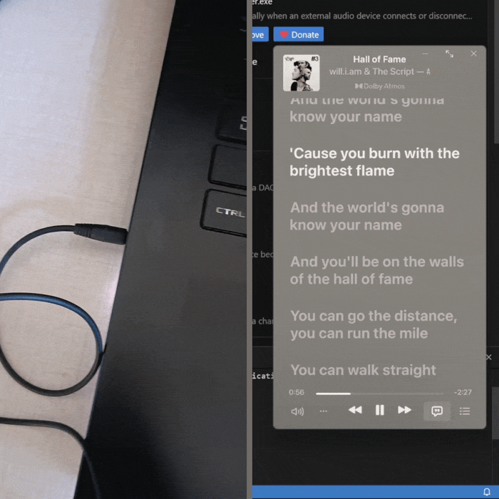

# Auto-Pause on Disconnect

A [Windhawk](https://windhawk.net/) mod for Windows that pauses what you are
listening to when your headphones leave the room: the 3.5 mm cable pulled out, a
Bluetooth headset dropped, a USB DAC unplugged. The pause lands after Windows has
moved the sound back to the built-in speakers, so you never get that one-second
blast through them.

It does not have to be a pause. The action is a setting, and so is whether it
runs on a disconnect, on a connect, or both.

## Features

| Feature | What it does |
| --- | --- |
| Every kind of unplug | Watches the default output device itself, so wired, Bluetooth, USB and docked removals are caught the same way. |
| Wait, then pause | Acts 300 ms after the switch by default, which is enough time for Windows to hand the stream back to the speakers. |
| Your choice of action | Toggle play/pause, mute the output, or unmute it. |
| Both directions | React to disconnects, connects, or both. Connects are off by default. |
| Only when playing | Acts only while an app has audio running, so it never starts playback on its own. On by default. |
| No double toggles | One unplug raises several device notifications; repeats inside a one second window are folded into a single action. |
| Hands off | Switching the output by hand, while the old device is still plugged in, is left alone. |
| Its own process | Runs in a dedicated Windhawk process instead of inside Explorer, so a problem here cannot take the shell down. |

## Settings

| Setting | Default | What it does |
| --- | --- | --- |
| When a device disconnects | On | Act when the current output device goes away. |
| When a device connects | Off | Also act when a newly plugged device becomes the default output. |
| Audio role to watch | Multimedia | Which default-device role counts: Multimedia, Console, or Both. |
| Action | Toggle play/pause | Play/pause, mute the default output, or unmute it. |
| Delay before acting (ms) | 300 | How long Windows gets to move the stream, 0 to 3000. Raise it if sound still leaks through. |
| Ignore repeats within (ms) | 1000 | The window used to fold the notifications of a single unplug into one action, 0 to 5000. |
| Act only while audio is playing | On | Skip the action when nothing is playing, which turns play/pause into a real pause. |

## Requirements

- Windows 10 or Windows 11.
- [Windhawk](https://windhawk.net/) installed and running.

## Installing

1. In Windhawk, go to the **Mods** tab and click **Create new mod**.
2. Set the id to `auto-pause-on-disconnect`, replace the template code with the
   whole of `auto-pause-on-disconnect.wh.cpp`, and click **Compile mod**.
3. Switch the mod on, then open its settings and pick the action.

The mod runs in a small process of its own, so Explorer is not touched and there
is nothing to restart when you toggle it.

## Things to know

- **Play/pause is a toggle, not a pause.** If playback was already stopped, the
  key starts it again. *Act only while audio is playing* is on by default for
  that reason, and the Windows disconnect sound is not counted as playback;
  turn it off if you would rather the action always ran.
- **The mute action applies to whatever is default after the switch**, which is
  normally the internal speakers. Plug the headphones back in and they are left
  alone. Turning on *When a device connects* with the unmute action is a handy
  pair, if you want sound back the moment the headset returns.
- **Connecting a device looks almost exactly like a disconnect** to Windows: the
  default output moves either way. The mod sorts the two apart by watching which
  device ids were just added or removed, but a slow driver can report the switch
  first. That is why connects are opt-in.
- **Bluetooth devices can take a moment to disappear.** If a dropped headset still
  shows as connected for a second or two, raise the delay a little.

## How it works

The mod runs in its own Windhawk process and registers an `IMMNotificationClient`
with the Windows Core Audio API. Every time the default multimedia output changes,
the callback says which device inherited the role, and the mod compares that with
the devices that were just added or removed to tell a connect from a disconnect.
A change that fits neither is a manual switch, so the mod checks whether the old
device is still active and stays quiet if it is.

One thread owns the COM apartment, the enumerator and the callback registration.
The callback only wakes it; that thread waits out the delay, runs the playback
check and then sends `VK_MEDIA_PLAY_PAUSE` with `SendInput` or mutes the endpoint
through `IAudioEndpointVolume`. The wait is on an event, so disabling the mod
returns at once instead of sitting out the delay.

Turning the mod off unregisters the callback, joins that thread without a
timeout and releases everything, including the COM apartment, in order.

## License

MIT.
